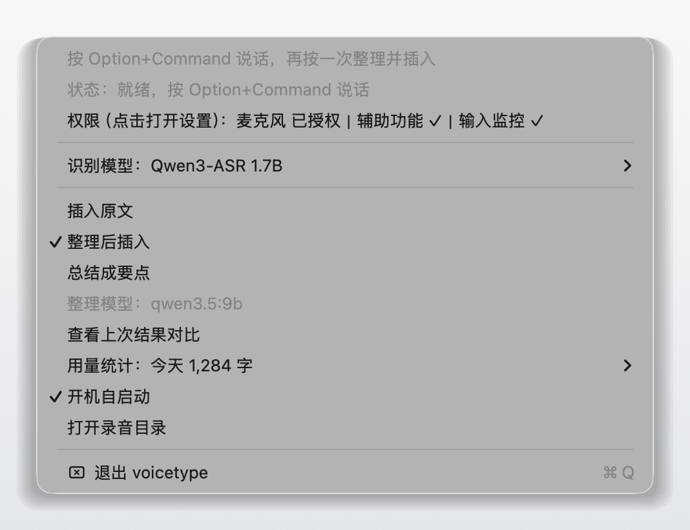
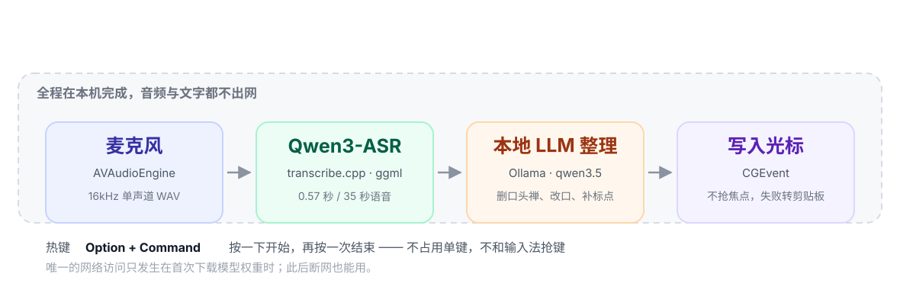
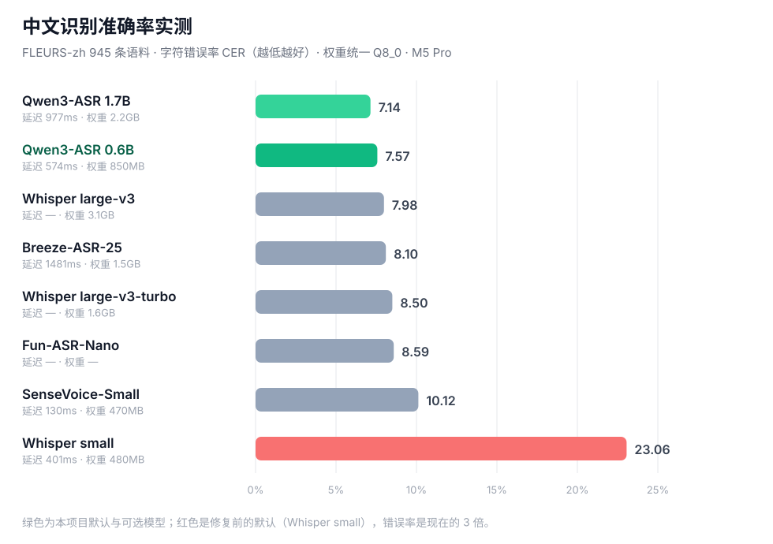

<p align="center">
  
</p>

<h1 align="center">voicetype</h1>

<p align="center">
  按一下 Option+Command 说话，光标处直接出现<b>「整理过的文字」</b>——不是逐字稿。<br/>
  识别、整理全部在你自己的 Mac 上跑，断网也能用。
</p>

<p align="center">
  <a href="https://github.com/yinshiqi2012-ops/voicetype/releases/latest"></a>
  
  
  
  
</p>

<p align="center">
  
  <br/>
  <sub>说话时屏幕底部浮出一个胶囊，波形跟着你的音量跳动</sub>
</p>

---

## 目录

- [它解决什么问题](#它解决什么问题)
- [长什么样](#长什么样)
- [它是怎么工作的](#它是怎么工作的)
- [用哪套模型](#用哪套模型)
- [安装](#安装)
- [权限：为什么需要这三个](#权限为什么需要这三个)
- [输出字数统计](#输出字数统计)
- [可配置项](#可配置项)
- [资源占用](#资源占用)
- [排障](#排障)
- [隐私](#隐私)
- [项目结构](#项目结构)
- [开发](#开发)
- [已知限制](#已知限制)
- [许可与致谢](#许可与致谢)
- [English](#english)

---

## 它解决什么问题

语音输入的老问题是：**转出来的东西没法直接用。**

你对着麦克风说「嗯那个明天下午吧不对是三点，我在会议室等你」，得到的是逐字稿 `嗯那个明天下午吧不对是三点我在会议室等你`。口头禅、改口、缺标点全都在，删改的成本常常比重新打字还高。于是很多人试了两天就回去敲键盘了。

voicetype 的取舍是：**识别之后再过一遍本地大模型**，把这段话变成「明天下午三点，我在会议室等你。」——只保留你最终想表达的意思，不改数字、不改时间，出事就退回原文。

第二个取舍是**不上云**。会议纪要被上传到别人服务器这件事，很多人是不愿意的；而且云端延迟基本在 1 秒以上、还要账号和订阅。这里整条链路都在本机：

| 方案 | 需要联网 | 口语整理 | 音频是否离开本机 | 价格 |
|---|---|---|---|---|
| macOS 自带听写 | 可离线 | 不做，只出逐字稿 | 否 | 免费 |
| 云端语音输入（讯飞 / 妙记等） | 是 | 部分支持 | **是** | 订阅 |
| Whisper 桌面工具（MacWhisper 等） | 可离线 | 多数不整理，靠你自己复制粘贴 | 否 | 免费/付费 |
| **voicetype** | 只有首次下载模型 | **默认整理**，一句话直出成稿 | 否 | 免费开源 |

它不打算取代专业转写软件：**长音频转写、说话人分离、多语言会议记录**不是它的目标。它就是「我要往光标里放一句话」这件事的快捷键。

## 长什么样

菜单栏一个麦克风图标，点开是这样（截图里的字数是示例数据）：

<p align="center">
  
</p>

| 菜单项 | 作用 |
|---|---|
| 状态 | 就绪 / 录音中 / 识别中 / 整理中，出错时这里写原因 |
| 权限 | 三项权限的状态，缺哪个点一下就跳到对应设置页 |
| 识别模型 | Qwen3-ASR 1.7B / 0.6B / Whisper small，切换后自动热加载 |
| 插入原文 / 整理后插入 / 总结成要点 | 三种输出模式，改完立刻生效，不需要重启 |
| 整理模型 | 当前用的 Ollama 模型与就绪状态 |
| 查看上次结果对比 | 把「识别原文」和「最终插入的文字」并排摊开，看整理到底帮了忙还是帮了倒忙 |
| 用量统计 | 字数统计，见[下文](#输出字数统计) |
| 开机自启动 | 勾一下，登录后自动常驻 |
| 打开录音目录 | 录音会留档，方便回听校验 |

录音时屏幕底部浮出胶囊：说话时波形跟着音量起伏，停下来识别时文字变成「正在识别…」。它不抢焦点、不进 Dock、不切窗口——你可以一直在原来的输入框里打字。

## 它是怎么工作的

<p align="center">
  
</p>

四步，全程本机：

1. **录音** — `AVAudioEngine` 采 16kHz 单声道，落成 WAV；顺带算 RMS 电平喂给胶囊的波形。
2. **识别** — [transcribe.cpp](https://github.com/handy-computer/transcribe.cpp)（ggml/Metal）跑 Qwen3-ASR。35 秒语音约 0.57 秒出结果，比实时快 60 倍以上。
3. **整理** — 请求本机 [Ollama](https://ollama.com) 的 `qwen3.5:9b`：删口头禅、合并改口、补标点。提示词在 `TranscriptCleanup.swift` 里，输出会被清洗（去 ``` 围栏、去「整理后：」这类前缀、拒绝对话式回答）。
4. **写入光标** — 用 `CGEvent` 投递 Unicode 键盘事件到 HID 层，等价于真实键盘输入，不切换应用、不碰剪贴板。

两道兜底：

- **事实校验**：整理后如果数字、时间跟原文对不上（比如「三点」被改成「两点」），直接丢弃整理结果、用原文。宁可不动，不能改错。
- **注入兜底**：事件投递被系统静默丢弃时（安全输入框等），自动改成复制到剪贴板，并在菜单状态里说明，绝不出现「既没插进去又不留后路」。

## 用哪套模型

<p align="center">
  
</p>

中文识别用的是 `fleurs-zh` 945 条语料的字符错误率（CER，越低越好），本机 M5 Pro 实测：

| 模型 | 中文 CER | 35 秒语音耗时 | 权重体积 | 说明 |
|---|---|---|---|---|
| Qwen3-ASR 1.7B | **7.14%** | 977 ms | 2.2 GB | 最准，也最吃内存 |
| **Qwen3-ASR 0.6B** | **7.57%** | 574 ms | 850 MB | **默认**。跟 1.7B 只差 0.4 个百分点，体积和延迟都少一半以上 |
| Whisper large-v3 | 7.98% | — | 3.1 GB | 多语言更均衡 |
| Breeze-ASR-25 | 8.10% | 1481 ms | 1.5 GB | 台湾华语语料友好 |
| Whisper large-v3-turbo | 8.50% | — | 1.6 GB | |
| Fun-ASR-Nano | 8.59% | — | — | |
| SenseVoice-Small | 10.12% | **130 ms** | 470 MB | 最快，精度明显掉一档 |
| Whisper small | 23.06% | 401 ms | 480 MB | 旧的默认，**错误率是现在的 3 倍** |

用你自己 6 段真实口述交叉验证过：Qwen3-ASR 对 Whisper small 是 5:1 胜；唯一输的场景是「中英混说 + 不规则数字串」（`9B` 被听成「酒杯」，`zephyr4123` 被听成中文词）。

怎么选：

- **日常用 0.6B**。中文准确率已经够用，启动 0.6 秒、内存省 1.6GB，适合在后台常驻。
- 需要啃专业术语、人名地名多的场景切 1.7B，代价是内存翻倍、延迟接近一倍。
- Whisper small 保留着只是因为它是旧版本默认值，除非你要多语言，否则没有理由用它。

模型的下载走 `hf-mirror.com` 优先、`huggingface.co` 兜底，国内网络不会卡在第一次启动。

## 安装

### 方式一：下载现成 App（推荐）

1. 从 [Releases](https://github.com/yinshiqi2012-ops/voicetype/releases/latest) 下 `voicetype-x.y.z-macos.zip`，解压后把 `Voicetype.app` 拖进「应用程序」。
2. 去隔离属性（自签名应用没有公证，不去掉会被 Gatekeeper 拦）：

   ```bash
   xattr -dr com.apple.quarantine /Applications/Voicetype.app
   ```

   或者在 Finder 里右键 App → 打开 → 仍要打开。

3. 首次启动会申请麦克风权限；随后按[权限](#权限为什么需要这三个)一节把三项都授权，**然后重启一次应用**。

### 方式二：从源码构建

需要 macOS 14+、Xcode Command Line Tools。**不需要 cmake**——原生推理库以 xcframework 形式随仓库分发。

```bash
git clone https://github.com/yinshiqi2012-ops/voicetype.git
cd voicetype
./scripts/build-app.sh          # 产物：dist/Voicetype.app
open dist/Voicetype.app
```

首次运行会自动下载识别模型（850MB 或 2.2GB）。整理功能需要本机有 [Ollama](https://ollama.com)：

```bash
ollama pull qwen3.5:9b
```

不想用整理功能的话，菜单里选「插入原文」即可，那样连 Ollama 都不会启动。

## 权限：为什么需要这三个

macOS 不会给一个菜单栏小工具默认放行这些能力，三项都要你手动开：

| 权限 | 用在哪 | 不开会怎样 |
|---|---|---|
| **麦克风** | 录音 | 完全没法用 |
| **输入监控**（Input Monitoring） | 监听 Option+Command 组合键 | 热键没反应 |
| **辅助功能**（Accessibility） | 向其他应用投递键入事件 | 能识别，但光标处没字（会退化成复制到剪贴板） |

授权的坑：在「系统设置 → 隐私与安全性」里勾选之后，**必须重启应用**才生效——`CGEventTap` 的授权状态是进程启动时读的。

应用用固定的自签名证书（`Voicetype Dev`）签名，重新构建不会丢授权。如果你是下载的 zip，可能会看到「无法验证开发者」，用上面的 `xattr` 命令处理即可。

## 输出字数统计

菜单栏「用量统计」实时给出这些数字，展开菜单即重新计算：

| 项 | 口径 |
|---|---|
| 最近 1 小时 / 最近 24 小时 | 滚动窗口，按每笔输出的真实时间戳回算 |
| 今天 | 自然日 |
| 近 7 天 / 近 30 天 | 按自然日累加（含今天） |
| 历史累计 | 全部历史 |
| 每日明细 | 最近 14 天，逐日一行 |
| 复制统计摘要 | 把全部内容作为纯文本复制到剪贴板 |

计的是**最终输出的字符数**（插入成功或退化成剪贴板都算），空识别不计。

存储上做了个折中：**每日桶永久保留**（撑起累计和月度统计），**逐条明细只留 48 小时**（滚动窗口需要精确时间戳，按天存桶做不到跨天回退）。裁剪旧明细不会丢账，因为累计来自每日桶。

```bash
# 命令行查看
VOICETYPE_PRINT_USAGE=1 /Applications/Voicetype.app/Contents/MacOS/voicetype

# 清空统计
rm "~/Library/Application Support/voicetype/usage.json"
```

## 可配置项

全部通过 `defaults` 改，改完重启应用：

```bash
defaults write com.truman.voicetype asrEngine    "qwen3-asr-0.6b"   # qwen3-asr-0.6b / qwen3-asr-1.7b / whisper-small
defaults write com.truman.voicetype polishMode   "clean"           # off / clean / summary
defaults write com.truman.voicetype polishModel  "qwen3.5:9b"
defaults write com.truman.voicetype modelEndpoint "https://huggingface.co"
defaults write com.truman.voicetype language     ""                # 空 = 自动检测；默认固定 zh
```

`polishMode` 的三档含义：`off` 只出逐字稿（不启动 Ollama），`clean` 删口头禅补标点（默认），`summary` 直接压成要点。

## 资源占用

本机（M5 Pro / 48GB）实测，单位为物理内存占用（`phys_footprint`，模型用的是 mmap，RSS 会虚高）：

| 组件 | 常驻内存 | 说明 |
|---|---|---|
| voicetype（0.6B） | ≈ 1.5 GB | 默认配置 |
| voicetype（1.7B） | ≈ 3.1 GB | 峰值 3.5 GB |
| Ollama 主进程 | ≈ 1.4 GB | 只在整理模式开启时加载 |
| 模型磁盘占用 | 850 MB / 2.2 GB | 每个引擎各存一份 |

两个可以省的开关：切到 0.6B 省 1.6GB；`polishMode=off` 则完全不加载 Ollama。整理模型在 Ollama 里被钉住常驻（`keep_alive: -1`），所以不会有「每句话都冷启动」的等待。

## 排障

| 症状 | 原因与处理 |
|---|---|
| 按 Option+Command 没反应 | 缺「输入监控」权限；授权后需重启应用 |
| 有识别结果但光标处没字 | 缺「辅助功能」权限；此时文字会进剪贴板 |
| 菜单栏是三角感叹号 | 菜单「状态」那行写了具体原因 |
| 整理没生效 | Ollama 没运行，或没 pull 对应模型；「整理模型」那行会说明 |
| 识别很慢（十几秒） | 模型被换出内存。`ollama ps` 看常驻；整理模式设「插入原文」则不加载 Ollama |
| 首次启动卡住 | 在下载模型（850MB 或 2.2GB），看菜单状态行 |
| 一句话出来两遍 | 同时开了两个实例（比如 `dist/` 那份和 `/Applications` 那份）。新版会在启动时关掉旧实例，日志里有 `single instance: 关闭 1 个旧实例` |
| 退出时弹「意外退出」 | 旧版本遗留（ggml 的 Metal 静态析构断言）；0.2.0 起退出会跳过该析构，不再产生崩溃报告 |
| 不小心按出 ⌘⌥ 组合键 | 这两个键在很多应用里有含义，目前热键还不可改（见[已知限制](#已知限制)） |

链路日志（排障必备）：

```bash
log show --predicate 'subsystem == "com.truman.voicetype"' --last 10m --style compact
```

会看到一条完整链路：`asr ready: engine=… → transcribed: chars=… → polished: … → finish: insert result=…`。

## 隐私

- 语音、识别结果、整理请求**都不离开本机**。整理请求发往 `127.0.0.1:11434`（你自己的 Ollama）。
- 唯一的网络访问是**首次下载模型权重**；之后断网可正常使用。
- 录音留档在 `~/Library/Application Support/voicetype/Recordings/`，**不会自动清理**，介意就定期删。
- 字数统计只写本地 `usage.json`，不上报任何数据；仓库里没有任何遥测代码。
- 应用没有账号系统、没有 API key、没有任何第三方 SDK。

## 项目结构

```
Sources/Voicetype/
├── AppDelegate.swift        菜单栏、状态机、流程编排、单实例接管
├── HotKeyMonitor.swift      CGEventTap 监听 Option+Command（边沿触发）
├── Recorder.swift           AVAudioEngine → 16kHz 单声道 WAV（含电平回调）
├── Transcriber.swift        识别引擎抽象：transcribe.cpp(Qwen3-ASR) / WhisperKit
├── ASREngine.swift          引擎与权重注册表
├── SpeechPolisher.swift     向本机 Ollama 请求整理
├── TranscriptCleanup.swift  整理提示词、输出清洗、数字/时间事实校验
├── TextInjector.swift       CGEvent 把文字写进光标
├── ListeningCapsule.swift   屏幕底部浮动胶囊（无边框非激活面板）
├── UsageStats.swift         输出字数统计（每日桶 + 48 小时明细，原子写盘）
├── Permissions.swift        四类系统权限的检测与跳转
├── LoginItem.swift          开机自启
└── Config.swift             所有默认值与可覆盖项

Vendor/transcribe-cpp/       vendored 的 transcribe.cpp Swift 绑定（MIT）
docs/images/                 README 用的截图与图表
scripts/build-app.sh         构建 .app（含框架嵌入与签名）
scripts/package-release.sh   打 zip 发布包
Tests/VoicetypeTests/        TranscriptCleanup 与 UsageStats 的单元测试
```

## 开发

```bash
swift build --disable-automatic-resolution   # 首次构建需要网络拉 WhisperKit
swift test                                   # 13 个单元测试
./scripts/build-app.sh                       # 构建可运行的 .app
VERSION=0.2.1 ./scripts/package-release.sh   # 打发布 zip
```

几个调试开关（都不进菜单，只给排障用）：

```bash
VOICETYPE_PREVIEW_CAPSULE=1 open -a Voicetype   # 只显示胶囊 5 秒，用来调样式
VOICETYPE_PREVIEW_MENU=1 /Applications/Voicetype.app/Contents/MacOS/voicetype  # 自动弹出菜单（截图用，Esc 关闭后退出）
VOICETYPE_DEBUG_RECORD=120 /Applications/Voicetype.app/Contents/MacOS/voicetype # 写入一条统计后打印并退出
```

## 已知限制

- **热键不可配置**，固定 Option+Command。这两个键在部分应用里本身有含义（比如切换窗口），快速按到会误触发；如果困扰你，可以在 issue 里提，加个可配置热键不难。
- **主要面向中文**。默认固定 `zh`，英文也可以但不保证标点；中英混说+不规则数字串是已知弱项。
- **Apple 的 FoundationModels 用不上**：在未开放该能力的机型上直接返回 `deviceNotEligible`，所以整理走 Ollama。
- **没有流式识别**：句子说完、按一下结束才开始识别（0.5–1 秒出结果），不支持边说话边往光标里蹦字。
- **自签名、未公证**：需要手动去隔离属性；首次授权要重启应用。
- 整理依赖 Ollama 常驻；不想承担这份内存就用「插入原文」模式。

## 许可与致谢

MIT。第三方组件：

- [transcribe.cpp](https://github.com/handy-computer/transcribe.cpp) — MIT，ggml 推理与 Swift 绑定
- [WhisperKit](https://github.com/argmaxinc/WhisperKit) — MIT
- Qwen3-ASR 权重 — Apache-2.0（不随仓库分发）
- [Ollama](https://ollama.com) / qwen3.5 权重 — 各自许可（不随仓库分发）
- 图标与界面全部自绘，没有第三方 UI 资源

---

## English

**Local-first dictation for macOS.** Press <kbd>Option</kbd>+<kbd>Command</kbd>, speak, press again — *cleaned-up* text lands at your cursor, not a verbatim transcript.

<p align="center">
  
</p>

Speech recognition runs on-device via [transcribe.cpp](https://github.com/handy-computer/transcribe.cpp) (ggml/Metal) with Qwen3-ASR; cleanup runs on a local [Ollama](https://ollama.com) model that removes filler words, merges self-corrections and adds punctuation. A fact check rejects any rewrite that changes numbers or times, falling back to the raw transcript. If synthetic keystrokes are dropped by the system, the text goes to the clipboard instead of getting lost.

**Nothing leaves the machine.** No account, no API key, no telemetry. The network is touched only to download model weights on first run.

| | Chinese CER ↓ | Latency (35 s audio) | Weights |
|---|---|---|---|
| Qwen3-ASR 1.7B | 7.14% | 977 ms | 2.2 GB |
| **Qwen3-ASR 0.6B** (default) | **7.57%** | 574 ms | 850 MB |
| Whisper small (legacy) | 23.06% | 401 ms | 480 MB |

Measured on `fleurs-zh` (945 utterances), M5 Pro, Q8_0 weights.

**Install**

```bash
# from source (macOS 14+, Command Line Tools — no cmake needed)
git clone https://github.com/yinshiqi2012-ops/voicetype.git
cd voicetype && ./scripts/build-app.sh && open dist/Voicetype.app
```

Or grab the prebuilt app from [Releases](https://github.com/yinshiqi2012-ops/voicetype/releases/latest), then:

```bash
xattr -dr com.apple.quarantine /Applications/Voicetype.app
```

Grant **Microphone**, **Input Monitoring** and **Accessibility** in System Settings → Privacy & Security, then relaunch (the event tap only picks up new grants at launch). For the cleanup step install Ollama and `ollama pull qwen3.5:9b`; without it, switch the menu to "insert raw transcript".

The menu also shows live output statistics (last hour / 24 hours / today / 7 days / 30 days / all-time, plus a 14-day breakdown), stored locally in `usage.json`.

Licensed under MIT.
